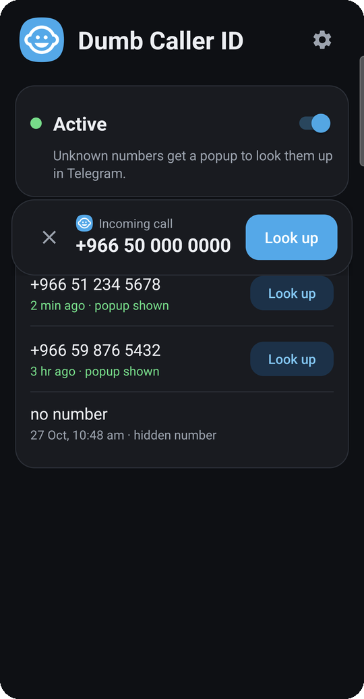
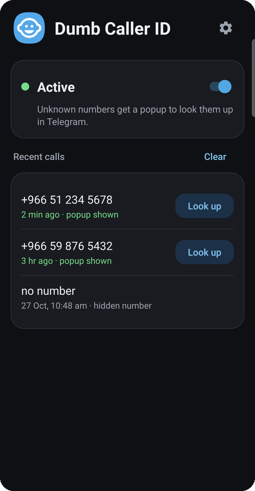
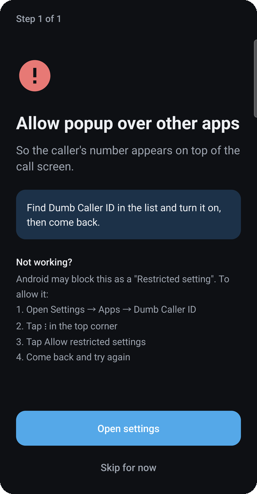
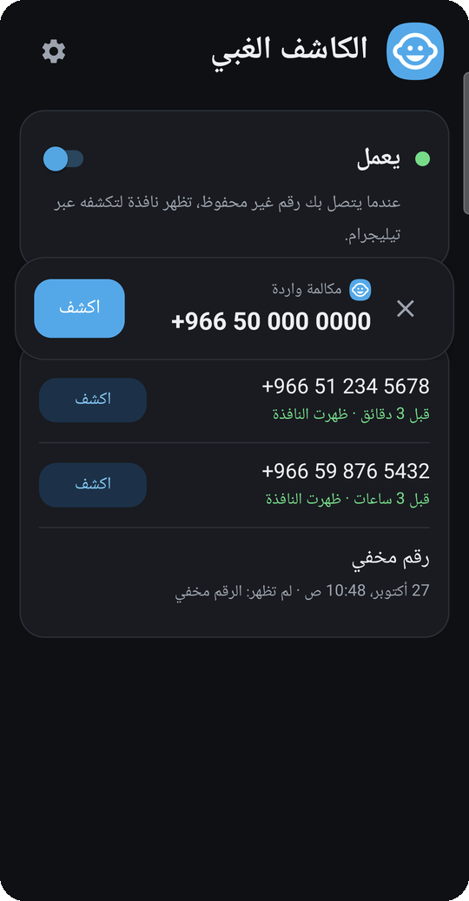
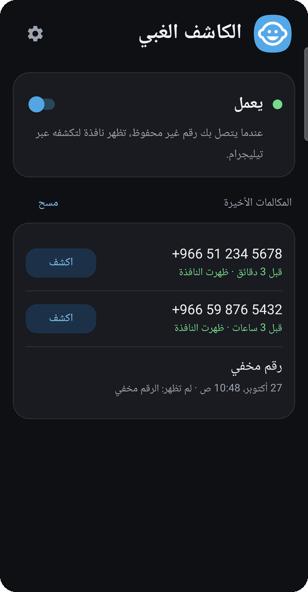

<div align="center">


# Dumb Caller ID

**Unknown number calling? A popup appears over the call. One tap looks it up on Telegram.**

[](https://github.com/tekno0ryder/dumb-caller-id/releases/latest)

[](https://github.com/tekno0ryder/dumb-caller-id/actions/workflows/build.yml)


[](LICENSE)

&nbsp;
&nbsp;


<sub>Also in Arabic</sub><br>
&nbsp;


</div>

## Features

- **Popup over the call screen** for numbers not in your contacts, even on a locked phone. Drag it anywhere; it closes when the call ends.
- **One tap to look up** the number through a Telegram bot of your choice.
- **Recent calls**, each with when it came in, whether the popup showed, and Look up.
- **Guided setup** that explains every permission, including Samsung, Xiaomi, OPPO, vivo and Huawei quirks.
- **Updates itself**: a notification when a new version is out, then one tap to install.

## Install

1. Download the APK with the button above, open it and tap Install. If asked, allow your browser or file app to install apps.
2. If Play Protect warns you, tap "More details" → "Install anyway".
3. Open the app and follow the setup steps.
4. In Telegram, open @dlilcomApp_bot and tap Start once.

New versions arrive as a notification; tap Update in the app to install. Your settings stay.

**Something not working?** In the app, tap Settings → Copy diagnostics and paste it into a [bug report](../../issues/new/choose). It contains no phone numbers.

## Privacy

No servers, analytics or ads, and the app never reads your contacts or call log. A number leaves your phone only when you tap Look up, and goes to the Telegram bot you chose, which a third party runs. Apart from that, the app only checks GitHub once a day for updates. Details: [PRIVACY.md](PRIVACY.md).

## For developers

**How it works.** `CallScreener` receives calls from unknown numbers through Android's caller ID role, `CallOverlay` draws the popup, and `Telegram` opens the bot. `Setup` and `Device` decide which setup steps a phone needs; `SettingsLauncher` opens their screens without crashing when a phone refuses one. `Updates` handles the daily check and install.

**Building** needs JDK 17 and the Android SDK (platform 36):

```sh
./gradlew lintDebug testDebugUnitTest   # lint (any warning fails) and unit tests
./gradlew assembleDebug                 # app/build/outputs/apk/debug/app-debug.apk
```

GitHub Actions runs the same on every push and pull request. Testing on a phone: [docs/TESTING.md](docs/TESTING.md). Publishing releases: [RELEASING.md](RELEASING.md).

**Contributing.** Bug reports and pull requests are welcome. Keep changes small and add a unit test for new logic.

## License

[MIT](LICENSE)
